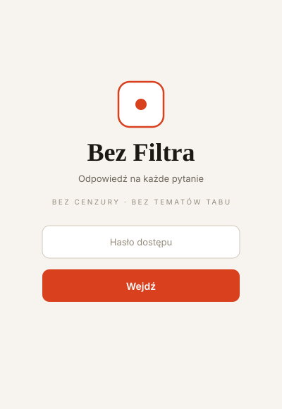
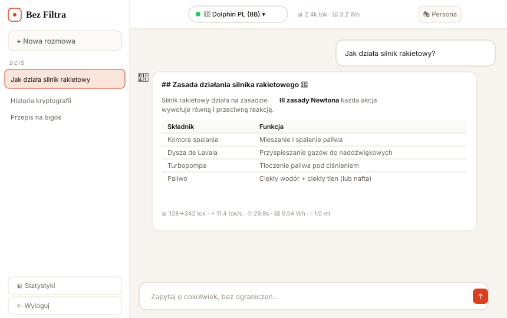
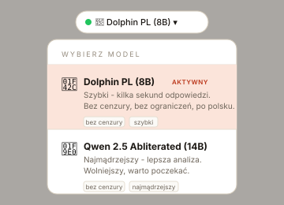
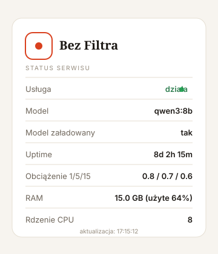
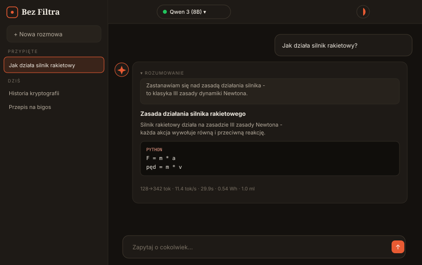

# Bez Filtra

**W pełni prywatny, lokalny asystent AI bez żadnej cenzury.**

Żadnych filtrów. Żadnych tematów tabu. Żadnych danych w chmurze.

🇵🇱 Polski (ten plik) · 🇬🇧 [English](README.en.md)

---

## Zrzuty ekranu

<table>
<tr>
<td align="center"> Ekran logowania</td>
<td align="center"> Interfejs czatu (jasny motyw)</td>
<td align="center"> Picker modelu</td>
</tr>
<tr>
<td align="center"> Strona statusu (PWA)</td>
<td align="center"> Interfejs czatu (ciemny motyw)</td>
<td></td>
</tr>
</table>

---

## Co to jest?

**Bez Filtra** to samodzielnie hostowany interfejs do modeli językowych (LLM) uruchamianych lokalnie przez [Ollama](https://ollama.ai). Działa na własnym serwerze, nie wysyła żadnych danych do zewnętrznych serwisów i nie nakłada żadnych ograniczeń na tematy rozmów.

Pomyśl o tym jak o prywatnym ChatGPT - ale bez cenzury, bez logowania do zewnętrznych serwisów i bez opłat za tokeny.

---

## Funkcje

- **Bez cenzury** - abliterowane modele (Qwen3, Dolphin, DeepSeek, Bielik...) bez odmów i moralizowania
- **W pełni lokalnie** - zero chmury, zero śledzenia, Twoje dane zostają u Ciebie
- **Dowolne modele** - picker pokazuje każdy model pobrany w Ollamie
- **Model per rozmowa** - każda konwersacja pamięta swój model
- **Jasny / ciemny / auto motyw** - przełącznik z zapamiętywaniem wyboru
- **Widok „rozumowania"** - zwijane bloki myślenia (Qwen3 / DeepSeek)
- **Auto-streszczanie** - długie rozmowy nie gubią kontekstu
- **Wyszukiwanie** - pełnotekstowe z przeskokiem do wiadomości (Cmd+K)
- **Przypinanie i eksport** - pin rozmów, eksport do Markdown
- **Regeneracja innym modelem** - porównuj odpowiedzi jednym kliknięciem
- **Live stats** - tokeny, tok/s, energia i woda w czasie rzeczywistym
- **PWA** - instalowalna aplikacja + osobna strona statusu
- **Markdown** - tabele, kod, listy renderowane natywnie

---

## Stack

| Warstwa | Technologia |
|---------|-------------|
| **Frontend** | React 19 + Vite + Tailwind CSS v4 + Framer Motion |
| **Backend** | Node.js + Express + TypeScript |
| **AI** | Ollama (lokalne LLM) |
| **Infra** | Docker Compose + Cloudflare Tunnel + nginx |
| **Auth** | JWT |

---

## Modele

Domyślnie serwis używa **`huihui_ai/qwen3-abliterated:8b`** (Q4_K_M, 5 GB) - najlepszy balans jakości do szybkości na CPU. Jako awaryjny mniejszy model ustawiony jest `huihui_ai/qwen3-abliterated:4b` (2.5 GB).

Picker w aplikacji pokazuje **każdy model faktycznie pobrany w Ollamie** - wystarczy `ollama pull <model>` i pojawia się w UI automatycznie, bez zmian w kodzie.

Sprawdzone modele abliterowane: Qwen3 (4B/8B/14B), Dolphin 3, DeepSeek R1, Qwen 2.5 - oraz polski Bielik (nie abliterowany).

---

## Dla deweloperów

Pełna dokumentacja techniczna - konfiguracja, wdrożenie, tuning wydajności, logi i utrzymanie - znajduje się w [**DEVELOPMENT.md**](DEVELOPMENT.md).

---

crafted by **NullPointer Studio** · *null safe, fully unchained*

